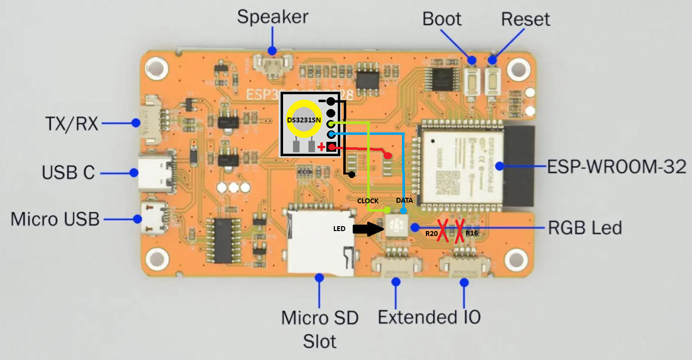

# Miniature DS3231SN RTC installation — IW1RMM CW Encoder v7.2.1

**Board:** ESP32-2432S028R CYD, matching the supplied wiring illustration. **Firmware:** v7.2.1.

The modification adds a miniature DS3231SN RTC module (approximately 10 × 10 mm), **not** the larger standard RTC board. Maintaining time while the CYD is switched off requires a working backup battery or other suitable backup supply on the RTC module.

## Wiring

| RTC module | CYD connection | Drawing color |
|---|---|---|
| `+` / VCC | Positive supply point shown (verify voltage first) | Red |
| `−` / GND | Ground point shown | Black |
| DATA / SDA | GPIO16 | Cyan |
| CLOCK / SCL | GPIO17 | Green |

Firmware I²C settings: SDA GPIO16, SCL GPIO17, 100 kHz, device address `0x68`.

**Safety:** verify the actual supply voltage, RTC module rating, backup-battery wiring and PCB revision before connecting. The drawing is board-revision-specific.

## Hardware procedure

1. Disconnect all power and peripherals.
2. Locate **R16 and R20**, marked with red crosses in the drawing.
3. **Desolder and remove both R16 and R20. Do not bridge them.**
4. **Leave the RGB LED physically installed**; it need not be removed. Some RGB LED functions may no longer work after this modification.
5. Fix the RTC module to the rear of the CYD using electrically insulating mounting material.
6. Solder the four wires according to the drawing. Use short insulated wires and avoid mechanical stress on solder pads.
7. Check polarity and continuity and inspect for solder bridges before applying power.

## Firmware and test

Version 7.2.1 reads the DS3231 on startup to initialize ESP32 system time. If the RTC does not answer, firmware prints an error and continues startup. The source uses the built-in ESP32 `Wire` library; no external `RTClib` is required.

- `\Z` reads the DS3231 date and time.
- `\ZDDMMYYYYHHMMSS` sets the clock using 14 digits after `\Z`, with no spaces.
- Example: `\Z17112026123456` (17 November 2026, 12:34:56).

The source includes these commands in Serial and BLE handling. Test RTC detection at 115200 baud, set and read the time, check the UI/keyer and then power-cycle after several minutes to confirm backup operation.

**Source:** IW1RMM hardware drawing and v7.2.1 source file. Exact commercial RTC module variant and CYD PCB revision remain to be identified for a fully universal installation guide.
