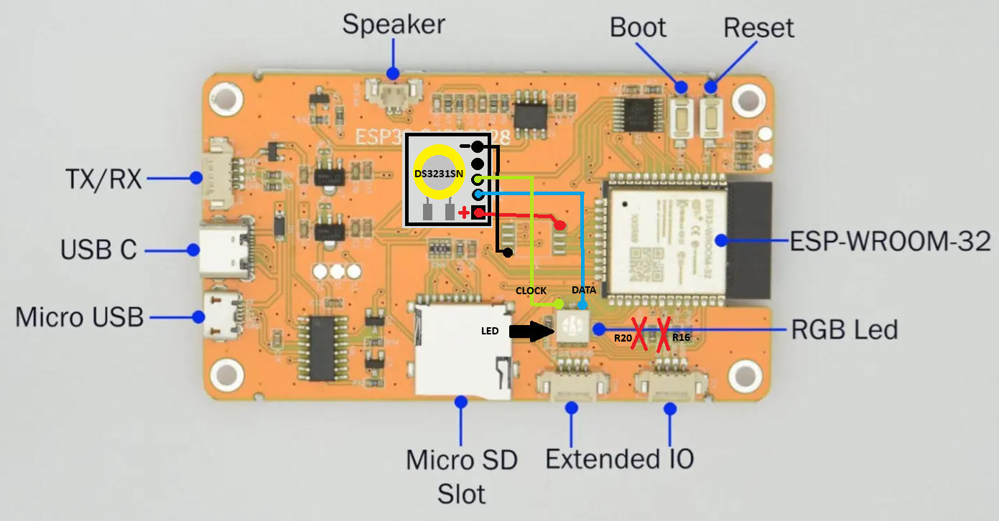

# Installazione RTC DS3231SN miniaturizzato — IW1RMM CW Encoder v7.2.1

**Lingua:** italiano · **Scheda:** ESP32-2432S028R (CYD), revisione e disposizione dei componenti come nella figura · **Firmware:** v7.2.1

Questa modifica permette al firmware di leggere l'orologio hardware DS3231 all'avvio. Il mantenimento dell'ora senza alimentazione del CYD richiede **una batteria di backup funzionante e correttamente collegata al modulo RTC**. Il disegno raffigura il modulo miniaturizzato DS3231SN di circa 10 × 10 mm, non la comune scheda RTC grande con portabatteria CR2032.



*Figura: disegno di montaggio fornito da IW1RMM; vista del retro del CYD. I punti colorati indicano i collegamenti e le X rosse indicano R20 e R16 da rimuovere. La figura è specifica per la scheda rappresentata.*

## Materiale necessario

- CYD ESP32-2432S028R compatibile con la figura.
- Modulo RTC DS3231SN miniaturizzato (circa 1 × 1 cm), con alimentazione e backup compatibili.
- Quattro fili sottili isolati, utensili per microsaldatura, isolamento e materiale di fissaggio non conduttivo.
- Multimetro per verificare alimentazione, continuità e assenza di cortocircuiti.

## Collegamenti

| Sul modulo RTC | Segnale | Collegamento al CYD | Nel disegno |
|---|---|---|---|
| `+` / VCC | Alimentazione | Punto positivo indicato in figura (verificarne la tensione) | Rosso |
| `−` / GND | Massa | Punto di massa indicato in figura | Nero |
| DATA / SDA | Bus I²C dati | **GPIO16** | Azzurro |
| CLOCK / SCL | Bus I²C clock | **GPIO17** | Verde |

Il firmware usa `Wire.begin(16, 17)` con bus a 100 kHz e indirizzo I²C `0x68`.

**Importante:** non dedurre il voltaggio del modulo soltanto dai simboli `+`/`−`. Verificare la serigrafia o lo schema del modulo e misurare la tensione del punto positivo del CYD prima di collegarlo. Un DS3231SN lavora tipicamente con alimentazione a bassa tensione, ma il circuito di un modulo specifico può comprendere componenti aggiuntivi. Verificare anche come è alimentato `VBAT` e l'eventuale presenza della batteria di backup.

## Modifica hardware

1. **Scollegare tutti i cavi di alimentazione e le periferiche.** Attendere che la scheda sia completamente spenta.
2. Individuare **R16 e R20** nella zona del LED RGB, come evidenziato dalle due X rosse nel disegno.
3. **Rimuovere entrambe le resistenze R16 e R20.** Non ponticellarle. Controllare con lente che non restino cortocircuiti o piazzole danneggiate.
4. **Lasciare fisicamente montato il LED RGB.** Non è necessario dissaldarlo. Dopo la modifica alcune funzioni luminose del LED RGB potrebbero non essere più disponibili.
5. Posizionare il modulo RTC sul retro del CYD nella zona illustrata. Fissarlo con materiale **isolante** senza coprire o mettere in corto piste e componenti.
6. Eseguire le quattro saldature rispettando il disegno: `+`, GND, SDA/DATA (GPIO16), SCL/CLOCK (GPIO17). Tenere i fili corti, isolati e senza tensione meccanica sulle piazzole.
7. Prima dell'accensione, controllare con multimetro polarità, continuità dei segnali, isolamento tra alimentazione e massa, e assenza di ponti di stagno.

**Avvertenza:** questa è una modifica con microsaldature, riferita alla revisione della scheda mostrata nella foto. Una revisione differente può avere piste, resistenze e punti di saldatura differenti. Non usare il disegno alla cieca su un altro CYD.

## Comportamento del firmware 7.2.1

- All'avvio prova a rilevare il DS3231 a indirizzo I²C `0x68` e, se riesce a leggerlo, sincronizza l'orologio interno ESP32.
- Se il DS3231 non risponde, segnala l'errore sul monitor seriale e prosegue il resto dell'inizializzazione.
- Il comando `\Z` (senza argomenti) legge la data/ora dal DS3231; il comando `\Z GGMMAAAAHHMMSS` imposta data e ora. Entrambe le forme sono gestite dal codice per la seriale e per BLE.
- Il codice 7.2.1 usa la libreria `Wire` inclusa nel core ESP32, senza richiedere `RTClib`.

Esempio di impostazione per il 17 novembre 2026, ore 12:34:56:

```text
\Z17112026123456
```

Inviare **senza spazi** dopo `\Z`. La data nell'esempio è illustrativa, non l'ora attuale.

## Collaudo consigliato

1. Caricare il firmware 7.2.1 e aprire il monitor seriale a **115200 baud**. Cercare `[RTC] Hardware DS3231 trovato sul bus I2C!` e `[RTC-BOOT-OK]`.
2. Impostare data e ora con `\Z` più 14 cifre; poi inviare `\Z` da solo e controllare la lettura.
3. Verificare che il display mostri un orario che avanza e che il keyer e le altre funzioni continuino a operare normalmente.
4. Scollegare l'alimentazione del CYD per alcuni minuti, quindi riaccendere e verificare che l'orologio abbia mantenuto l'ora. **Questo test dipende dalla batteria di backup del modulo RTC.**
5. In caso di errore I²C: spegnere prima di intervenire, ricontrollare collegamenti, polarità e le due resistenze rimosse.

## Provenienza e limiti

- **Montaggio e disegno:** istruzioni dell'autore del progetto, IW1RMM. R16 e R20 da rimuovere; LED RGB da lasciare montato.
- **Software:** verificato sul sorgente `VK2IDL_Morse_CYD_LVGL_721.ino` fornito dall'autore.
- **Non ancora documentati:** sigla commerciale esatta del modulo RTC, caratteristiche del suo circuito di backup e revisione PCB del CYD. Verificarli prima di pubblicare istruzioni valide per altre varianti hardware.
