# IW1RMM CW Encoder
Live demo:  
https://mfalco1959.github.io/IW1RMM_CW_Encoder/
**Firmware v7.2.1 — IW1RMM (Mauri)**

Morse code keyer WinKey WK3-compliant per ESP32-2432S028R (CYD), con display ILI9341 320×240 touchscreen.
Basato sul firmware originale di VK2IDL, esteso e adattato per il CYD.

---

## Hardware

### Schema elettrico

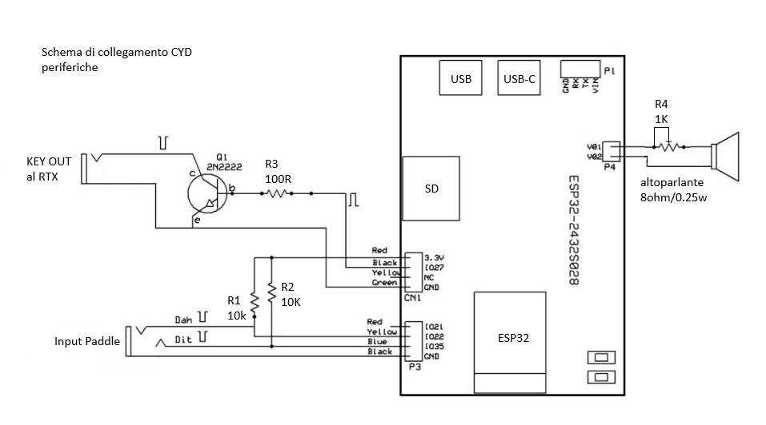

### Collegamento paddle e tasto verticale

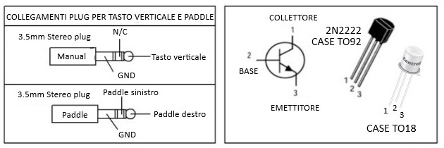

### Vista interna dei collegamenti

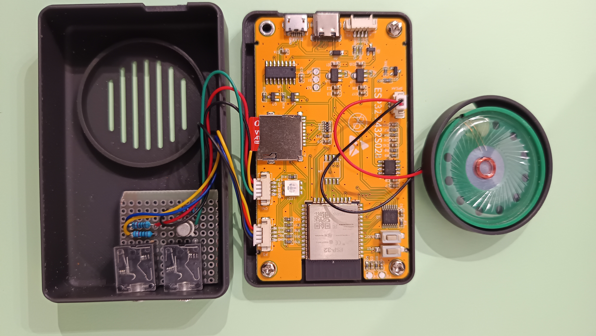

### Vista d'insieme

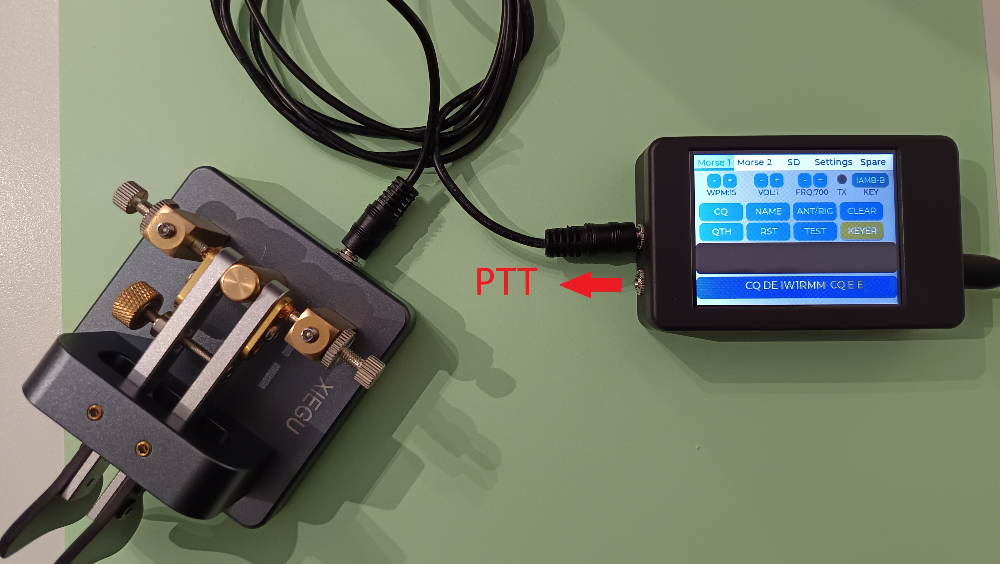

---

## Funzionalità

- WinKey WK3 via USB Serial (1200 baud)
- K3NG ASCII command set via Serial e BLE Nordic UART
- LVGL touchscreen UI (5 tab)
- Modalità keyer: Iambic A/B, Bug, Auto, Ultimatic
- SD card playback con logging CSV
- QRSS / HSCW / Beacon / Contest
- Calibrazione touch interattiva a 4 punti
- Orologio con offset GMT e RTC hardware DS3231SN miniaturizzato (v7.2.1), con sincronizzazione all’avvio e mantenimento dell’ora durante lo spegnimento se il modulo dispone di alimentazione di backup
- Farnsworth, Prosign, DAH ratio, Spacing weight
- Memorie K3NG A–Z (NVS)
- Messaggi preimpostati (6 slot, NVS)

---

## RTC DS3231SN — modifica hardware v7.2.1

La versione 7.2.1 integra il piccolo modulo RTC DS3231SN (circa 10 × 10 mm) sulla scheda ESP32 CYD. Il firmware usa il bus I²C a 100 kHz, legge l'ora dal DS3231 all'avvio e permette lettura e impostazione mediante il comando `\Z` tramite seriale e BLE.

**Modifica del CYD documentata per la scheda utilizzata nel progetto:** rimuovere le resistenze **R16 e R20**; **lasciare montato il LED RGB**. Fissare il modulo sul retro del CYD e realizzare i quattro collegamenti secondo il disegno di montaggio:

| RTC | CYD | Segnale |
|-----|-----|---------|
| + (VCC) | Alimentazione compatibile con il modulo e la logica a 3,3 V | Positivo |
| − (GND) | GND | Massa |
| DATA (SDA) | GPIO16 | Dati I²C |
| CLOCK (SCL) | GPIO17 | Clock I²C |

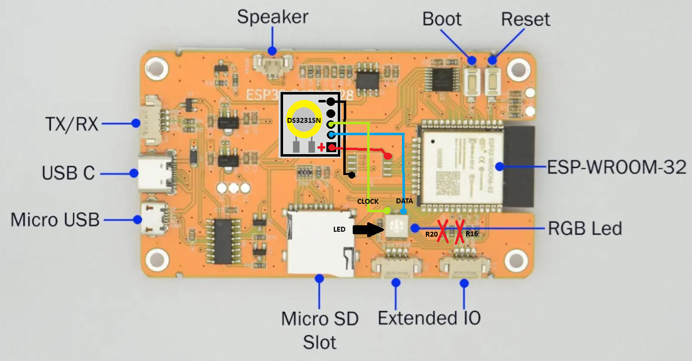

**[Guida completa al montaggio RTC — Italiano](IW1RMM_CW_Encoder/docs/RTC_DS3231_INSTALLAZIONE.md)** · [English installation guide](IW1RMM_CW_Encoder/docs/RTC_DS3231_INSTALLATION_EN.md)

> Prima di alimentare, verificare la piedinatura e la tensione ammessa dallo specifico modulo RTC e l'assenza di cortocircuiti. L'autonomia a dispositivo spento richiede una batteria o altra alimentazione di backup effettivamente presente e funzionante.

---

## Interfaccia — Screenshots

### Tab Morse 1

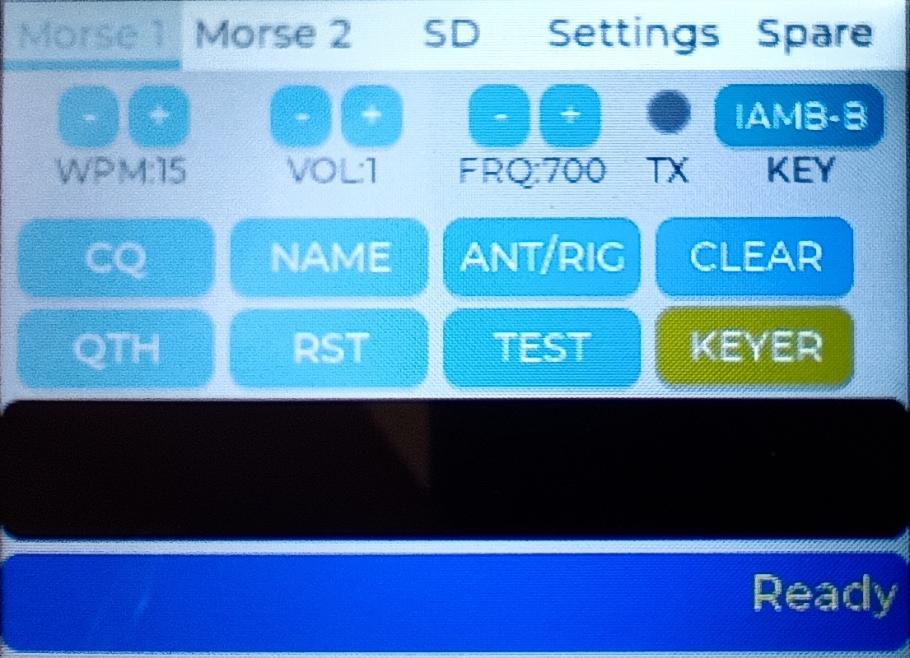

### Keyboard — long press

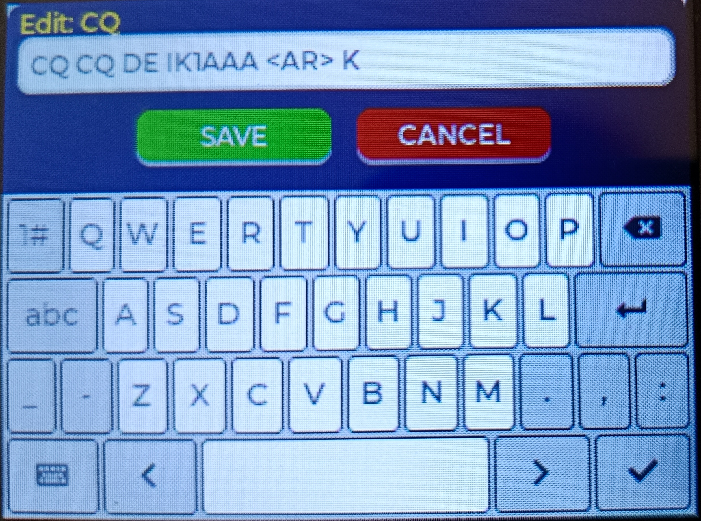

### Tab Morse 2

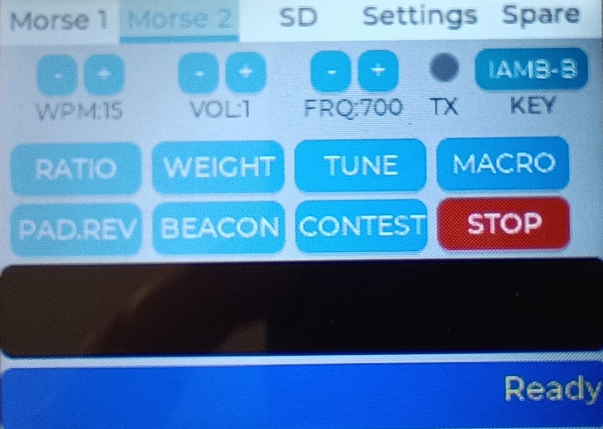

### Tab SD

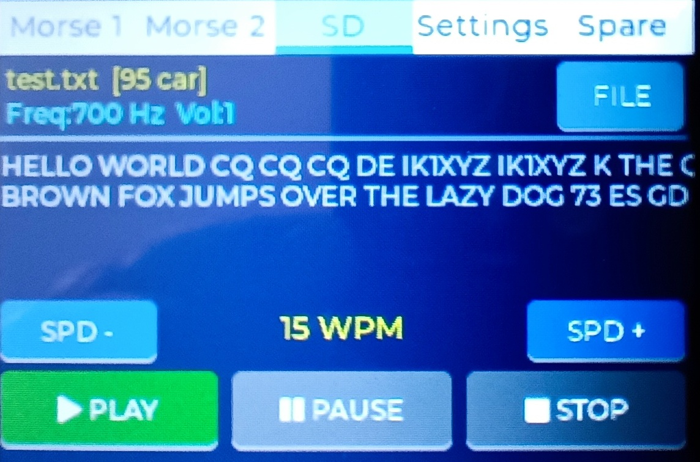

### Tab Settings — stato di default

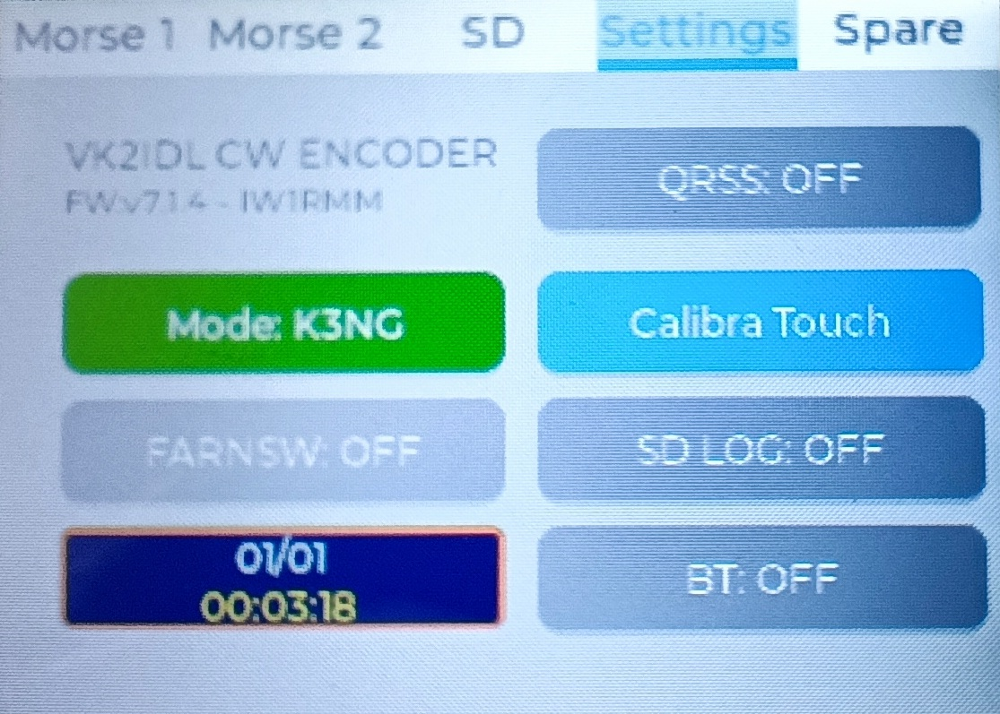

### Tab Settings — con i tasti attivi

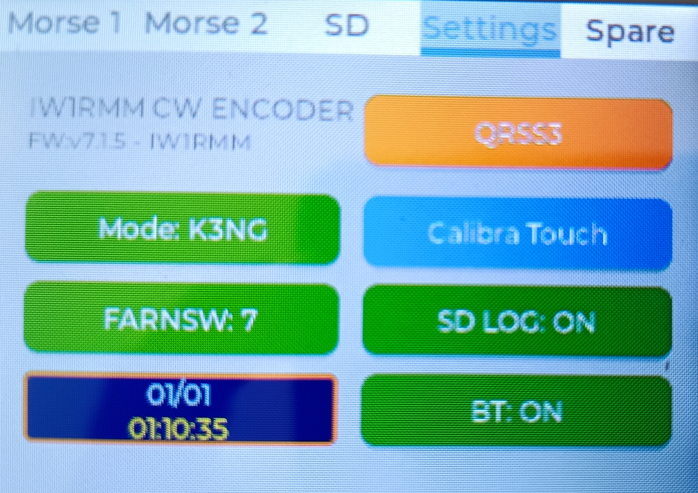

---

## BLE

Il firmware espone un servizio Nordic UART (NUS) con nome **VK2IDL_Morse**.  
Supporta lo stesso set di comandi K3NG disponibile via Serial.

### Comandi K3NG via BLE — screenshot smartphone

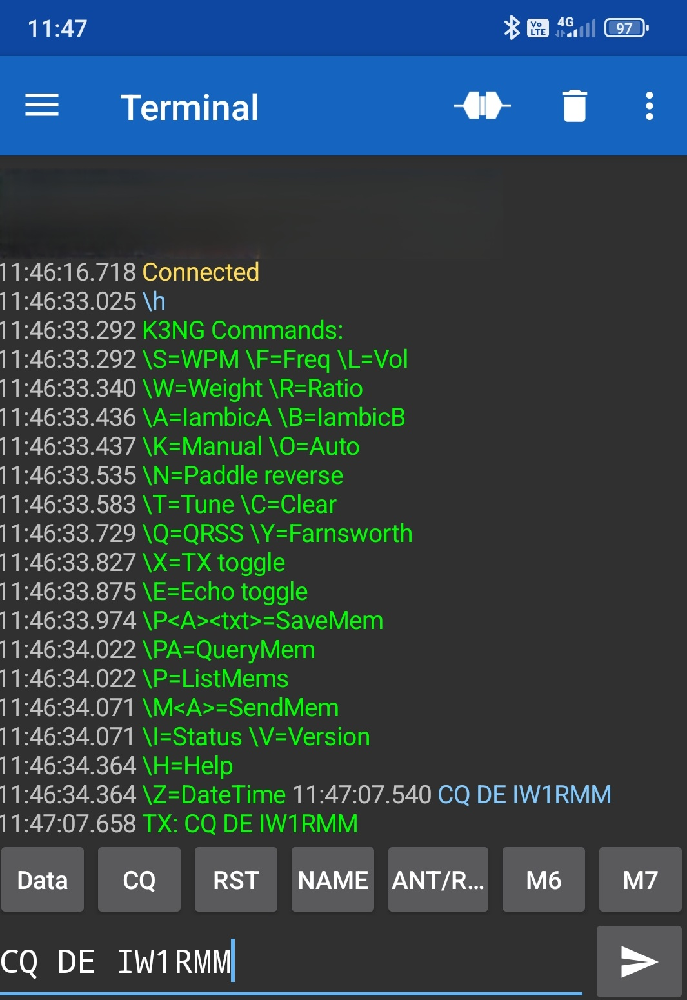

---

## Pinout ESP32-2432S028R (CYD)

| GPIO | Funzione | Note |
|------|----------|-------|
| 27 | KEY / PTT output | Uscita keyer |
| 26 | Sidetone DAC | Audio 300–1200 Hz |
| 22 | DIT input | Paddle |
| 21 | DAH input | Paddle |
| 5 | SD_CS | SPI SD card |
| 23 | SD_MOSI | SPI SD card |
| 19 | SD_MISO | SPI SD card |
| 18 | SD_SCK | SPI SD card |
| 2 | TFT_RS | Display ILI9341 |
| 15 | TFT_CS | Display ILI9341 |
| 4 | XPT2046 CS | Touch |
| 36 | XPT2046 IRQ | Touch interrupt |

---

## Dipendenze (librerie Arduino)

| Libreria | Versione | Autore |
|----------|----------|--------|
| lvgl | **8.4.0** | LVGL |
| TFT_eSPI | **2.5.43** | Bodmer |
| XPT2046_Touchscreen | **1.4** | Paul Stoffregen |
| DacESP32 | **2.1.2** | Thomas Jentzsch |
| Preferences (NVS) | built-in | Espressif |
| BLE (BLEDevice/BLEServer/BLEUtils/BLE2902) | built-in | Espressif |

> ⚠️ Testato con ESP32 Arduino Core **3.x**. Le librerie BLE e DacESP32 richiedono Core 3.x — non usare la versione 2.x.

---

## Installazione

1. Clona il repository
```bash
git clone https://github.com/mfalco1959/IW1RMM_CW_Encoder.git
```
2. Copia `IW1RMM_CW_Encoder/include/lv_conf.h` nella cartella dello sketch (stessa directory di `IW1RMM_CW_Encoder.ino`)
3. Configura `User_Setup.h` di TFT_eSPI (vedi `IW1RMM_CW_Encoder/docs/User_Setup_example.h`)
4. Compila con Arduino IDE — board: **ESP32 Dev Module**  
   In **Tools**, imposta:
   - Flash Mode: **DIO**
   - Flash Frequency: **40MHz**
   - Partition Scheme: **Huge APP (3MB No OTA/1MB SPIFFS)**
   - Upload Speed: **115200**
5. Upload via Arduino IDE — il firmware è di grandi dimensioni, **l'upload richiederà alcuni minuti**.

> ⚠️ **DIO + 40MHz sono obbligatori.** Le schede CYD usano spesso il chip flash ZBIT ZB25VQ32, sensibile a impostazioni QIO o 80MHz — l'uso di QIO o 80MHz può causare errori di upload o boot loop.

> 💡 **Velocità di upload:** 115200 baud è il valore sicuro e raccomandato. Se si prevede di fare pochi upload è possibile provare a incrementare la velocità (es. 460800 o 921600) per ridurre i tempi, ma la stabilità dipende dal cavo USB e dal driver del PC.

---

## Comandi K3NG principali

| Comando | Funzione |
|---------|----------|
| `\Snn` | Imposta velocità (WPM) |
| `\Fnnnn` | Imposta frequenza sidetone (Hz) |
| `\Ln` | Imposta livello volume (0–4) |
| `\R nnn` | DAH ratio × 100 (es. \R300 = 3.0) |
| `\W nnn` | Spacing weight × 100 (es. \W100 = 1.0) |
| `\Y nn` | Farnsworth WPM (0 = disabilita) |
| `\Q n` | QRSS (0/3/6/10/30 secondi per dit) |
| `\T` | TUNE — portante continua |
| `\J` | Reset calibrazione touch |
| `\Z` | Legge data e ora dal DS3231 hardware |
| `\Z GGMMAAAAHHMMSS` | Imposta data e ora (anche sul DS3231 se rilevato) |
| `\G ±n` | Offset GMT |
| `\PA testo` | Salva memoria K3NG (A–Z) |
| `\MA` | Invia memoria K3NG A |
| `\P` | Lista tutte le memorie |
| `\?` | Help completo |

---

## Versione

| Versione | Data | Note |
|----------|------|------|
| v7.2.1 | 2026-11 | Integrazione dell’RTC hardware DS3231SN (GPIO16/17), sincronizzazione all’avvio, lettura e scrittura con `\Z`; documentazione della modifica al CYD. |
| v7.1.5 | 2026-03 | Ottimizzazione dei commenti e riduzione delle righe di codice; ritocchi ai testi. |
| v7.1.4 | 2026-03 | Calibrazione touch e ampliamento dei comandi K3NG. |

---

## Crediti

- Firmware originale: **VK2IDL**
- Modifiche, estensioni e adattamento CYD: **IW1RMM (Mauri)**, 2025–2026

---

## Licenza

GPL v3 — vedi file `LICENSE`
