# IW1RMM CW Encoder
Live demo:  
https://mfalco1959.github.io/IW1RMM_CW_Encoder/
**Firmware v7.2.1 — IW1RMM (Mauri)**

WinKey WK3-compliant Morse code keyer for the ESP32-2432S028R (CYD), with ILI9341 320×240 touchscreen display.
Based on the original firmware by VK2IDL, extended and adapted for the CYD platform.

---

## Hardware

### Schematic

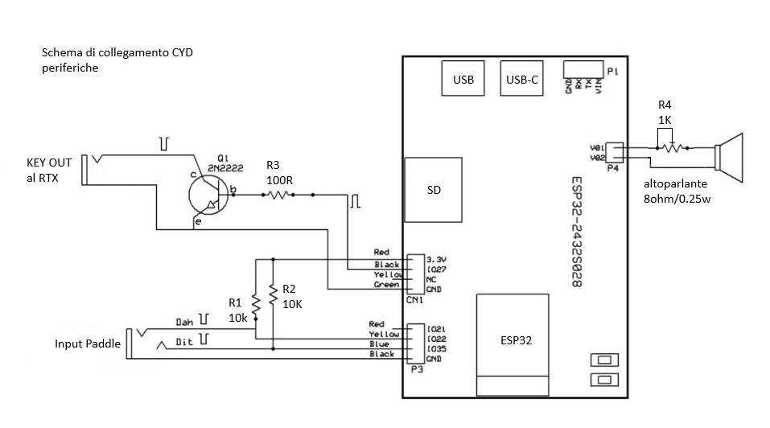

### Paddle and straight key wiring

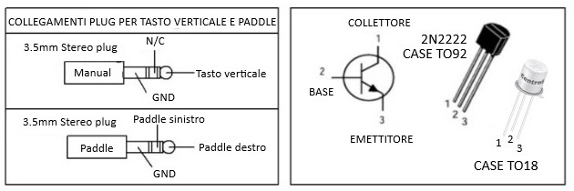

### Internal wiring

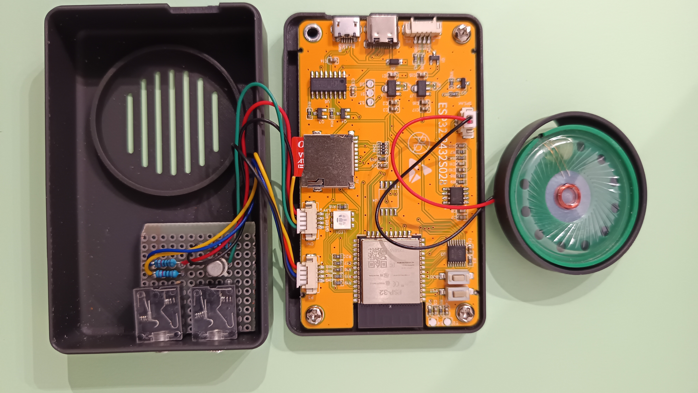

### Overview

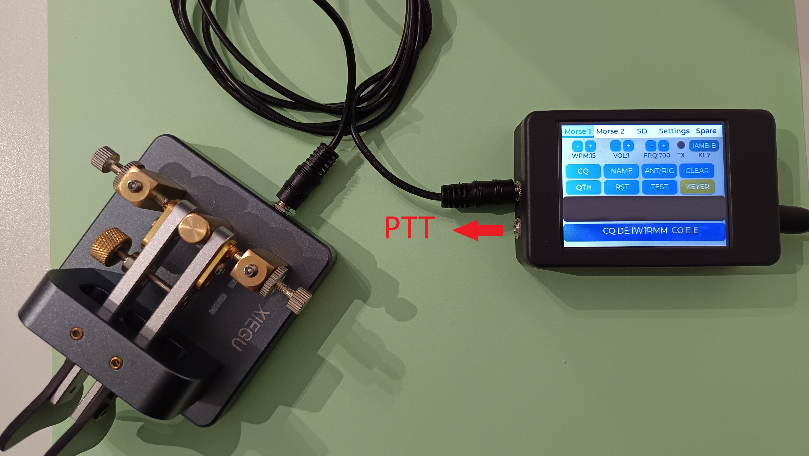

---

## Features

- WinKey WK3 via USB Serial (1200 baud)
- K3NG ASCII command set via Serial and BLE Nordic UART
- LVGL touchscreen UI (5 tabs)
- Keyer modes: Iambic A/B, Bug, Auto, Ultimatic
- SD card playback with CSV logging
- QRSS / HSCW / Beacon / Contest
- Interactive 4-point touch calibration
- Clock with GMT offset and miniature DS3231SN hardware RTC (v7.2.1), with time synchronization at boot and time retention when powered off if the RTC has a working backup supply
- Farnsworth, Prosign, DAH ratio, Spacing weight
- K3NG memories A–Z (NVS)
- 6 preset messages (NVS)

---

## DS3231SN RTC — v7.2.1 hardware modification

Version 7.2.1 integrates a miniature DS3231SN RTC module (approximately 10 × 10 mm) into the ESP32 CYD. The firmware uses a 100 kHz I²C bus, synchronizes system time from the RTC at boot, and supports reading and setting time with the `\Z` command over Serial and BLE.

**Modification documented for the CYD board used in this project:** remove resistors **R16 and R20**; **leave the RGB LED in place**. Mount the small RTC module on the back of the CYD and make the following four connections, following the original wiring illustration:

| RTC | CYD | Signal |
|-----|-----|--------|
| + (VCC) | Supply compatible with the RTC module and 3.3 V logic | Positive supply |
| − (GND) | GND | Ground |
| DATA (SDA) | GPIO16 | I²C data |
| CLOCK (SCL) | GPIO17 | I²C clock |

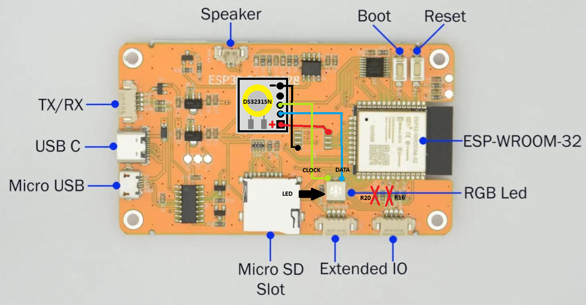

**[Full RTC installation instructions — English](IW1RMM_CW_Encoder/docs/RTC_DS3231_INSTALLATION_EN.md)** · [Guida in italiano](IW1RMM_CW_Encoder/docs/RTC_DS3231_INSTALLAZIONE.md)

> Before applying power, verify the pinout and permitted supply voltage of the actual RTC module, and check for shorts. Time retention with the CYD switched off requires a working backup battery or equivalent backup power source.

---

## Screenshots

### Tab Morse 1

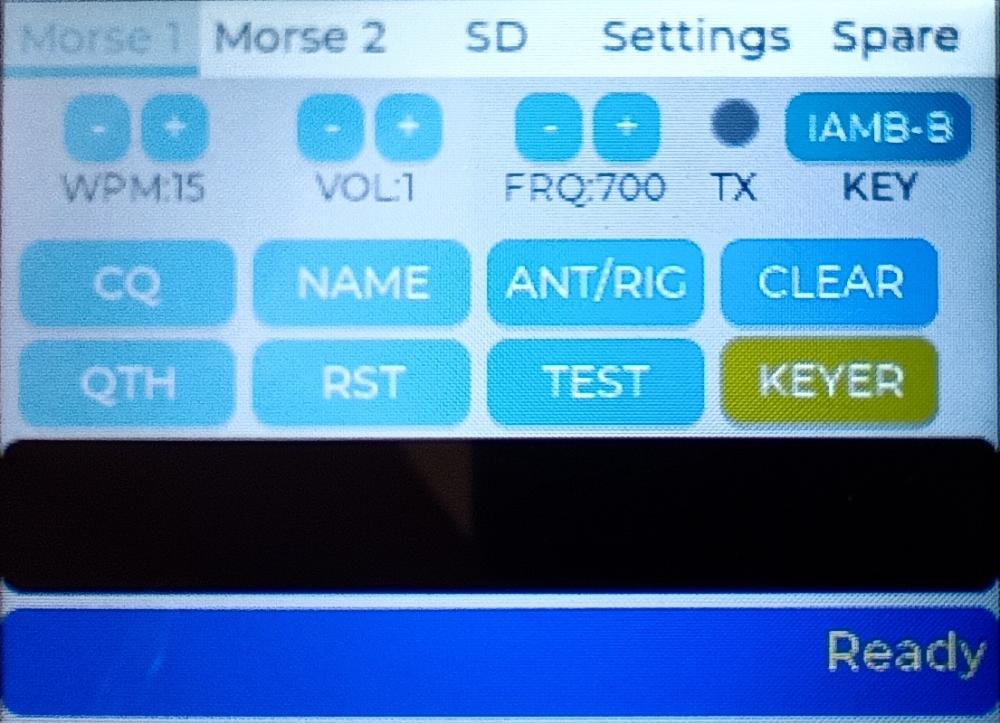

### Keyboard — long press

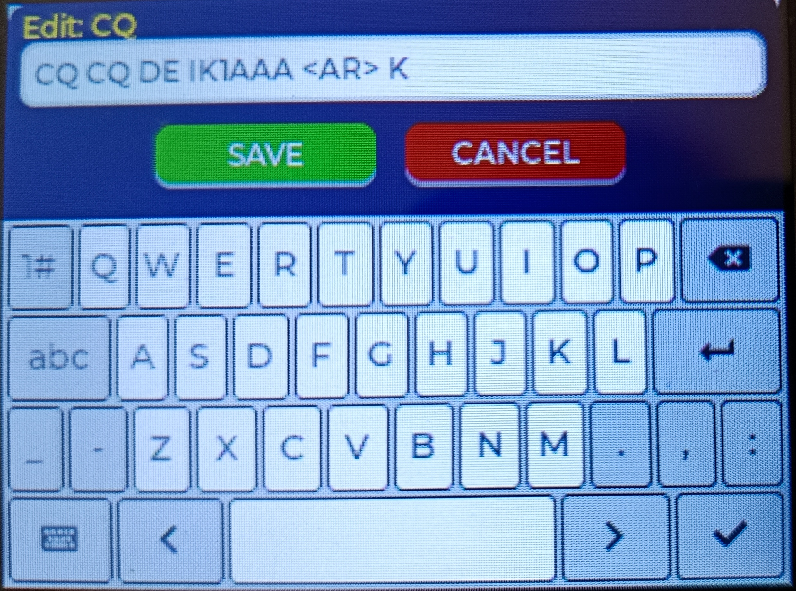

### Tab Morse 2

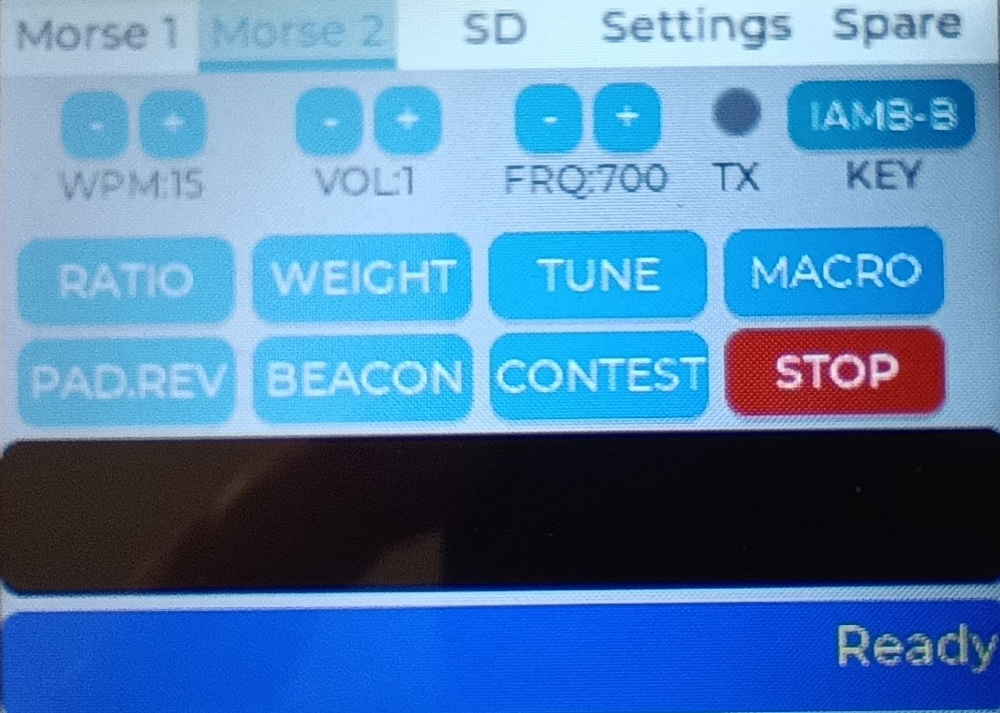

### Tab SD

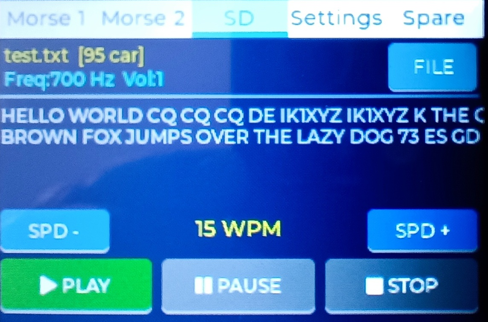

### Tab Settings — default state

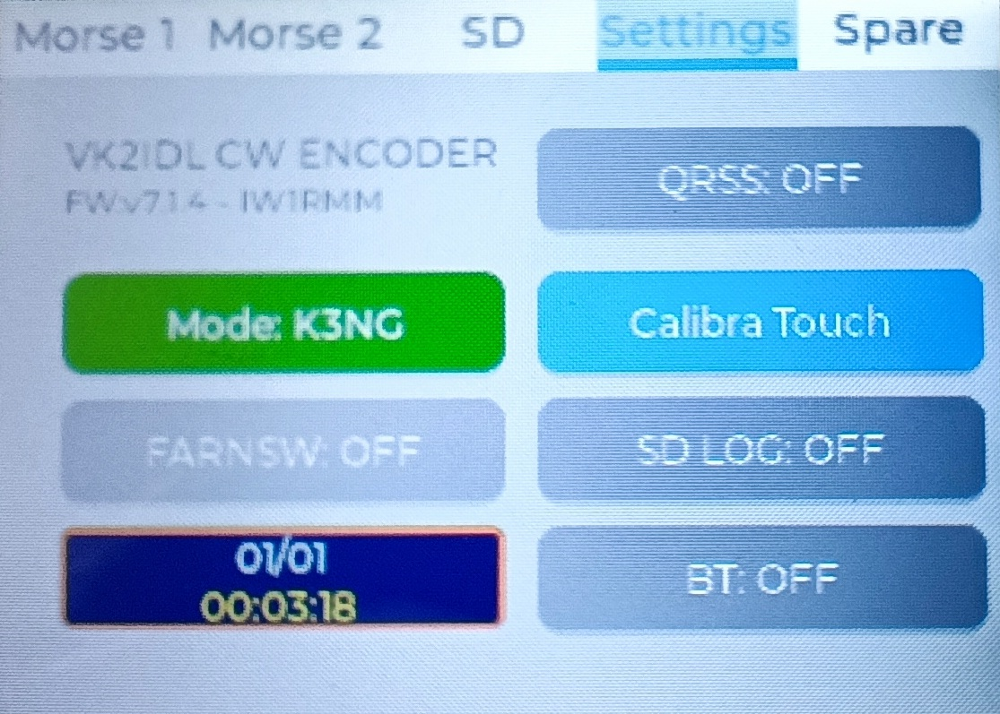

### Tab Settings — active buttons

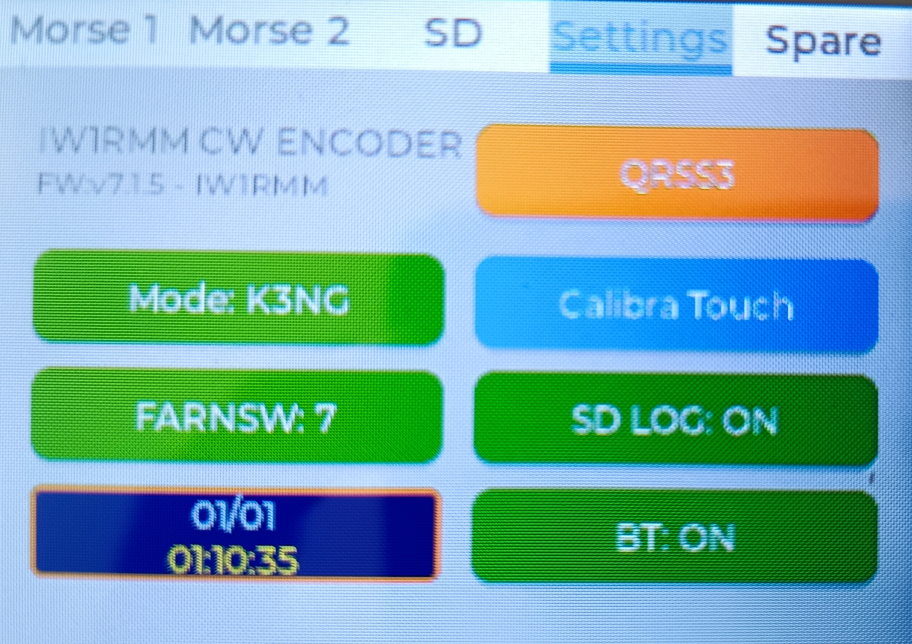

---

## BLE

The firmware exposes a Nordic UART Service (NUS) with device name **VK2IDL_Morse**.  
It supports the same K3NG command set available via Serial.

### K3NG commands via BLE — smartphone screenshot

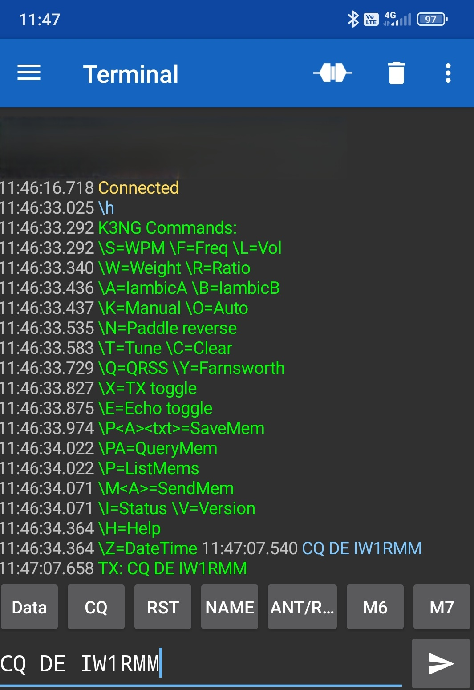

---

## Pinout ESP32-2432S028R (CYD)

| GPIO | Function | Notes |
|------|----------|-------|
| 27 | KEY / PTT output | Keyer output |
| 26 | Sidetone DAC | Audio 300–1200 Hz |
| 22 | DIT input | Paddle |
| 21 | DAH input | Paddle |
| 5 | SD_CS | SPI SD card |
| 23 | SD_MOSI | SPI SD card |
| 19 | SD_MISO | SPI SD card |
| 18 | SD_SCK | SPI SD card |
| 2 | TFT_RS | ILI9341 display |
| 15 | TFT_CS | ILI9341 display |
| 4 | XPT2046 CS | Touch |
| 36 | XPT2046 IRQ | Touch interrupt |

---

## Dependencies (Arduino libraries)

| Library | Version | Author |
|---------|---------|--------|
| lvgl | **8.4.0** | LVGL |
| TFT_eSPI | **2.5.43** | Bodmer |
| XPT2046_Touchscreen | **1.4** | Paul Stoffregen |
| DacESP32 | **2.1.2** | Thomas Jentzsch |
| Preferences (NVS) | built-in | Espressif |
| BLE (BLEDevice/BLEServer/BLEUtils/BLE2902) | built-in | Espressif |

> ⚠️ Tested with ESP32 Arduino Core **3.x**. The BLE and DacESP32 libraries require Core 3.x — do not use version 2.x.

---

## Installation

1. Clone the repository
```bash
git clone https://github.com/mfalco1959/IW1RMM_CW_Encoder.git
```
2. Copy `IW1RMM_CW_Encoder/include/lv_conf.h` into the sketch folder (same directory as `IW1RMM_CW_Encoder.ino`)
3. Configure TFT_eSPI `User_Setup.h` (see `IW1RMM_CW_Encoder/docs/User_Setup_example.h`)
4. Compile with Arduino IDE — board: **ESP32 Dev Module**  
   In **Tools**, set:
   - Flash Mode: **DIO**
   - Flash Frequency: **40MHz**
   - Partition Scheme: **Huge APP (3MB No OTA/1MB SPIFFS)**
   - Upload Speed: **115200**
5. Upload via Arduino IDE — due to the large sketch size, **upload will take several minutes**.

> ⚠️ **DIO + 40MHz are mandatory.** CYD boards often use ZBIT ZB25VQ32 flash chips that are sensitive to QIO or 80MHz settings — using QIO or 80MHz will cause upload failures or boot loops.

> 💡 **Upload speed:** 115200 baud is the safe recommended value. If you plan to upload only occasionally, you may try increasing the speed (e.g. 460800 or 921600) to reduce upload time, but stability depends on your USB cable and PC driver.

---

## K3NG Main Commands

| Command | Function |
|---------|----------|
| `\Snn` | Set speed (WPM) |
| `\Fnnnn` | Set sidetone frequency (Hz) |
| `\Ln` | Set volume level (0–4) |
| `\R nnn` | DAH ratio × 100 (e.g. \R300 = 3.0) |
| `\W nnn` | Spacing weight × 100 (e.g. \W100 = 1.0) |
| `\Y nn` | Farnsworth WPM (0 = disable) |
| `\Q n` | QRSS (0/3/6/10/30 seconds per dit) |
| `\T` | TUNE — continuous carrier |
| `\J` | Reset touch calibration |
| `\Z` | Read the hardware DS3231 date/time |
| `\Z DDMMAAAAHHMMSS` | Set date/time (and DS3231 if detected) |
| `\G ±n` | GMT offset |
| `\PA text` | Save K3NG memory (A–Z) |
| `\MA` | Send K3NG memory A |
| `\P` | List all memories |
| `\?` | Full help |

---

## Version

| Version | Date | Notes |
|---------|------|-------|
| v7.2.1 | 2026-11 | Miniature DS3231SN RTC integration (GPIO16/17), boot-time synchronization, `\Z` read/write, and CYD hardware modification guide. |
| v7.1.5 | 2026-03 | Code comments optimised, reduced code lines. Minor text adjustments. |
| v7.1.4 | 2026-03 | Touch calibration, prosign support, extended K3NG commands. |

---

## Credits

- Original firmware: **VK2IDL**
- Modifications, extensions and CYD adaptation: **IW1RMM (Mauri)**, 2025–2026

---

## License

GPL v3 — see `LICENSE` file
